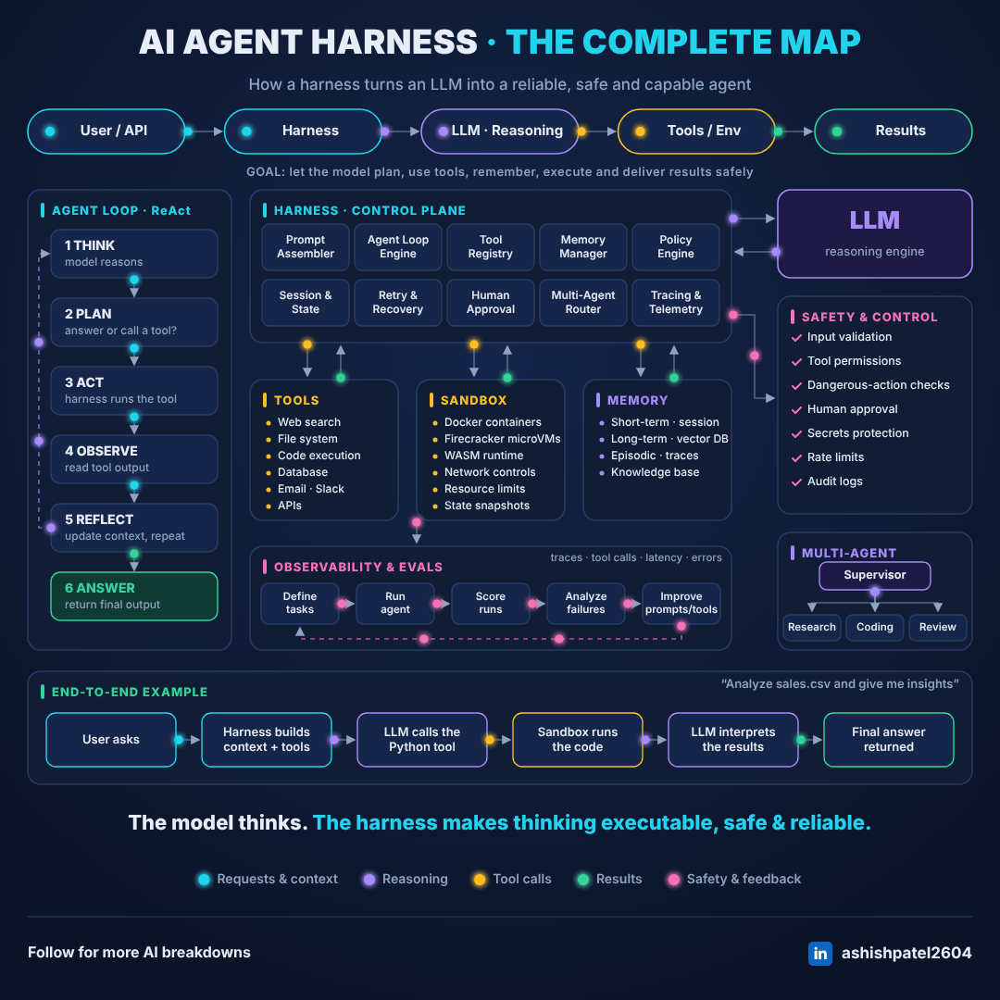
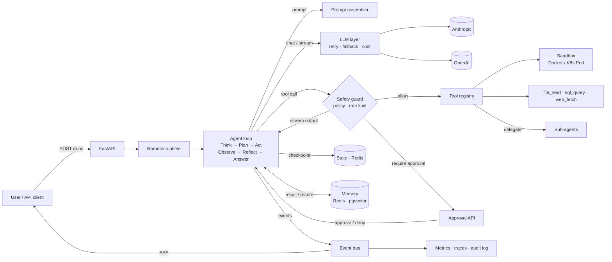

<div align="center">



# Enterprise-Agent-Harness-Project-Template

**A production-grade, open-source template for building reliable, safe and observable AI agents.**

[](https://github.com/ashishpatel26/Enterprise-Agent-Harness-Project-Template/actions/workflows/ci.yml)
[](https://github.com/ashishpatel26/Enterprise-Agent-Harness-Project-Template/actions/workflows/eval.yml)


[](LICENSE)


[**Quickstart**](#-5-minute-quickstart) ·
[**Features**](#-features) ·
[**Architecture**](#-architecture) ·
[**First agent**](#-create-your-first-agent) ·
[**Add a tool**](#-add-a-tool) ·
[**Docs**](#-documentation)

<a href="https://github.com/ashishpatel26/Enterprise-Agent-Harness-Project-Template/generate"></a>

</div>

---

## 💡 Why a harness?

**Agent = Model + Harness.** A model can plan and decide, but it cannot be trusted to run
code, touch data, stay on budget or recover from a crash by itself. The **harness** is
everything around the model that makes its reasoning **executable, safe and reliable**:

- **Executable.** An agent loop, tools, a sandbox, memory and multi-agent delegation.
- **Safe.** Policy, human approval, prompt-injection screening, secret redaction and an
  audit trail.
- **Reliable.** Retries, fallbacks, budgets, checkpoints, crash recovery, tracing and
  evals that gate every change.

This repo gives you all of it, wired together and tested, as a GitHub template. Use it to
ship a single agent, an internal **agent studio**, or your own **agent platform**.

## 🗺️ The complete map, in code

Every box on the map at the top of this page is a package in this repo:

| On the map | In the code |
|---|---|
| Agent loop · ReAct | [`src/harness/core`](src/harness/core) |
| Prompt assembler · Agent loop engine · Session & state · Retry & recovery | [`prompts`](src/harness/prompts) · [`core`](src/harness/core) · [`state`](src/harness/state) · [`llm`](src/harness/llm) |
| Tool registry · Tools | [`src/harness/tools`](src/harness/tools) |
| Sandbox | [`src/harness/sandbox`](src/harness/sandbox) |
| Memory manager · Memory | [`src/harness/memory`](src/harness/memory) |
| Policy engine · Human approval · Safety & control | [`src/harness/safety`](src/harness/safety) |
| Multi-agent router · Multi-agent | [`src/harness/orchestration`](src/harness/orchestration) |
| Tracing & telemetry | [`src/harness/observability`](src/harness/observability) |
| Observability & evals | [`src/harness/evals`](src/harness/evals) |
| End-to-end example: "Analyze sales.csv" | [`agents/data_analyst.yaml`](agents/data_analyst.yaml) → `make demo` |

## ✨ Features

| Layer | What you get |
|---|---|
| 🔁 **Agent loop** | Think → Plan → Act → Observe → Reflect → Answer; max steps, token/cost budgets, wall-clock timeout, parallel tool calls, a clean stop reason on every run |
| 🧠 **LLM layer** | One `LLMProvider` interface; Anthropic and OpenAI adapters; `FakeLLM` for tests; retries with full-jitter backoff; per-call timeouts; provider fallback; token and cost accounting |
| 📝 **Prompts** | Versioned templates (`react@v1`); memory injection; append-only history with one-shot compaction, so prompt caching and Claude's preserved thinking stay valid |
| 🧰 **Tools** | `@tool` registration from type hints; JSON-schema validation; per-tool timeouts; output caps; `read` / `write` / `dangerous` permissions; plugin entry points |
| 📦 **Sandbox** | Docker (no network, read-only rootfs, non-root, caps dropped, resource limits) or one Kubernetes Pod per run with optional gVisor; escape tests in CI |
| 🗄️ **Memory** | Redis session history, pgvector semantic memory and episodic run records behind one `MemoryManager` |
| 🛡️ **Safety** | YAML policy engine; human approval (pause → approve/deny → resume) with a four-eyes option; prompt-injection screening; secret redaction; rate limits; hash-chained audit log |
| 💾 **State** | Checkpoint after every step and tool result; run leases; automatic crash recovery; at-most-once execution for side-effecting tools |
| 🤝 **Multi-agent** | Supervisor → research / coding / review sub-agents with isolated contexts, shared tools and memory, crash-safe child runs and cost roll-up |
| 📈 **Observability** | OpenTelemetry spans with GenAI conventions; Prometheus metrics; JSON logs with redaction; per-run trace view |
| 🧪 **Evals** | YAML task sets; exact, contains, regex, tool-use and stop-reason scorers; LLM-as-judge rubrics; reports; a baseline regression gate in CI |
| 🌐 **API** | FastAPI: runs, SSE streaming with resume, approvals, cancel, traces, health and metrics; API-key tenancy |
| 🚀 **Deploy** | Multi-stage non-root Dockerfile; docker-compose (Redis, pgvector, OTel, Jaeger); Helm chart with HPA, PDB, NetworkPolicies and least-privilege RBAC |

## 🏗️ Architecture



Full walkthrough, run lifecycle and extension points: [docs/architecture.md](docs/architecture.md).

## ⚡ 5-minute quickstart

Prerequisites: [uv](https://docs.astral.sh/uv/) and, for the sandbox, Docker.

```bash
git clone https://github.com/ashishpatel26/Enterprise-Agent-Harness-Project-Template.git
cd Enterprise-Agent-Harness-Project-Template
make setup            # uv sync + pre-commit hooks + .env from .env.example
make sandbox-image    # build the locked-down sandbox image
make demo             # the data analyst agent analyzes examples/data/sales.csv
```

> [!TIP]
> **No API key needed for the demo.** Without one, the model is replaced by a scripted
> trajectory. Prompting, policy, sandbox, tools, memory and events all run for real. Add
> `ANTHROPIC_API_KEY` to `.env` to run the real model.

<details>
<summary><b>Example output</b></summary>

```text
[step 1] plan: python_exec
[step 1] python_exec -> ok (188 ms)
Analysis of 705 orders from 2025-01-01 to 2025-12-31 (total revenue $185,388.63, average order $262.96).

Key insights:
1. West is the strongest region with $55,298.19 (29.8% of revenue); South is the weakest at 21.8%.
2. Gizmo is the top product by revenue ($81,050.70, 43.7%).
3. Online is the leading channel with 48.9% of revenue.
4. Seasonality: the best month was 2025-08 ($23,383.59) and the weakest 2025-04 ($8,464.16).
5. Discounted orders average $259.95 vs $265.55 at full price.

status=completed stop_reason=completed steps=2 tokens=181 cost=$0.0000 time=0.2s
```

</details>

<details>
<summary><b>No Docker? No make?</b></summary>

Use the unsafe local sandbox for development only (it has **no isolation**):

```bash
HARNESS_SANDBOX_BACKEND=local_unsafe HARNESS_ALLOW_UNSAFE_SANDBOX=true make demo
```

Every `make` target is a plain `uv run` command (see the `Makefile`). For example, on Windows:

```bash
uv run harness run data_analyst "Analyze data/sales.csv and give me insights"
```

</details>

### Run the API

```bash
make dev        # in-memory backends, auto-reload → http://localhost:8000/docs
make up         # full stack: API, Redis, Postgres+pgvector, OTel collector, Jaeger (:16686)
```

```bash
KEY=change-me-local-dev-key
curl -s localhost:8000/runs -H "X-API-Key: $KEY" -H "Content-Type: application/json" \
  -d '{"agent": "data_analyst", "input": "Analyze data/sales.csv and give me insights"}'

curl -N localhost:8000/runs/<run_id>/stream -H "X-API-Key: $KEY"                       # live SSE
curl -s "localhost:8000/runs/<run_id>/trace?format=html" -H "X-API-Key: $KEY" > trace.html
```

| Endpoint | Purpose |
|---|---|
| `POST /runs` | Start a run (`"wait": true` blocks until it finishes or pauses) |
| `GET /runs/{id}` | Status, answer, usage, cost, pending approvals (`?include_messages=true`) |
| `GET /runs/{id}/stream` | Server-Sent Events; reconnect with `Last-Event-ID` |
| `POST /runs/{id}/approve` | Approve or deny a gated tool call; the run resumes |
| `POST /runs/{id}/cancel` | Cancel a run |
| `GET /runs/{id}/trace` | Step timeline with LLM and tool timings (`?format=html`) |
| `GET /agents` | Configured agents |
| `GET /healthz` · `/readyz` · `/metrics` | Liveness, readiness, Prometheus |

## 🤖 Create your first agent

Agents are YAML; no Python needed. Add `agents/support.yaml`:

```yaml
name: support
description: Answers questions from the product docs in the workspace.
model:
  provider: anthropic          # or openai, fake, or a provider plugin
  name: claude-opus-5-5
  effort: medium
prompt:
  template: react@v1
  instructions: |
    Answer from the files in docs/. Quote the file you used. If the answer is not
    there, say so.
tools: [file_read]
limits: {max_steps: 8, timeout_s: 120, max_cost_usd: 0.50}
memory: {enabled: true, top_k: 3}
```

```bash
uv run harness run support "How do I reset my password?"
```

Agent definitions are validated at startup, so a typo in a tool or sub-agent name fails
fast. To build a team, use `prompt.template: supervisor@v1`, `tools: [delegate]` and
`sub_agents: [...]` (see [`agents/supervisor.yaml`](agents/supervisor.yaml)).

## 🧰 Add a tool

A tool is an async function. The JSON schema the model sees is generated from its
signature and docstring:

```python
# my_tools/weather.py
from typing import Literal

from harness.tools import Permission, ToolError, make_tool


async def get_weather(city: str, units: Literal["c", "f"] = "c") -> str:
    """Current weather for a city. Returns temperature and conditions."""
    if not city.strip():
        raise ToolError("city must not be empty")  # this message goes back to the model
    return f"{city}: 21°{units.upper()}, clear"


weather_tool = make_tool(get_weather, permission=Permission.READ, timeout_s=10)
```

Register it with an entry point. The harness discovers tools from installed packages,
including this repo:

```toml
# pyproject.toml
[project.entry-points."harness.tools"]
get_weather = "my_tools.weather:weather_tool"
```

Then:

1. Run `uv sync`.
2. Add `get_weather` to an agent's `tools`.
3. For `write` or `dangerous` tools, decide in [`policies/default.yaml`](policies/default.yaml)
   who may call it and whether it needs approval.

Providers and sandboxes plug in the same way; see the
[extension points](docs/architecture.md#extension-points).

## 🛡️ Safety by default

```yaml
# policies/default.yaml: first match wins
defaults: {read: allow, write: allow, dangerous: require_approval}
rules:
  - name: no-pii-tables
    tools: [sql_query]
    args: {query: {matches: "(?i)\\b(users|customers)\\b"}}
    effect: deny
  - name: analysts-run-sandboxed-code
    tools: [python_exec]
    agents: [data_analyst]
    effect: allow
```

- **Code** runs in a sandbox with no network, a read-only filesystem, a non-root user and
  hard limits. Escape tests run in CI.
- **Dangerous tools** pause the run until a human approves (`POST /runs/{id}/approve`).
- **Tool output** is screened for prompt injection, and secrets are redacted before they
  reach the model provider.
- **Every decision** is written to a tamper-evident audit log (`harness audit-verify`).

Threat model and production checklist: [docs/safety.md](docs/safety.md).

## 🧪 Development

```bash
make test        # pytest with coverage (FakeLLM: no API keys needed)
make cov         # + gate: >= 80% on core, tools, safety, sandbox
make lint        # ruff
make typecheck   # mypy --strict
make eval        # offline eval suites vs evals/baseline.json
make check       # everything CI runs
```

CI runs about 300 tests, including Docker sandbox escape tests and pgvector memory tests.
On every push to `main` it also runs the eval suite, which fails if behaviour regresses
against the baseline.

## 📁 Project layout

```text
src/harness/
├── core/            agent loop, run state, agent specs
├── llm/             providers, retry, fallback, pricing, FakeLLM
├── prompts/         versioned templates, assembler, compaction
├── tools/           registry + built-in tools
├── sandbox/         Docker, Kubernetes, unsafe-local backends
├── memory/          sessions, pgvector, episodes
├── safety/          policy, guard, approvals, audit, redaction, rate limits
├── state/           checkpoints, leases, idempotency
├── orchestration/   supervisor → sub-agent delegation
├── observability/   tracing, metrics, logging
├── evals/           task sets, scorers, runner
├── api/             FastAPI app, auth, SSE, traces
└── runtime.py · cli.py · events.py
agents/  policies/  evals/  examples/  deploy/helm/  docker/  docs/  tests/
```

## 📚 Documentation

| Guide | What's inside |
|---|---|
| [Architecture](docs/architecture.md) | Layers, run lifecycle, resumability, multi-agent, extension points |
| [Safety](docs/safety.md) | Threat model, policy, approvals, sandboxing, redaction, audit, checklist |
| [Evals](docs/evals.md) | Writing task sets, offline vs live, LLM judge, regression gate |
| [Deployment](docs/deployment.md) | Configuration, docker-compose, Kubernetes/Helm, operations |

## 🤲 Contributing

Contributions are welcome: new tools, providers, sandboxes, agents, docs. Read
[CONTRIBUTING.md](CONTRIBUTING.md) and report vulnerabilities privately as described in
[SECURITY.md](SECURITY.md).

## 📄 License

[MIT](LICENSE). Use it, fork it, ship it.

<div align="center">



If this template helps you, please ⭐ the repo.

</div>
