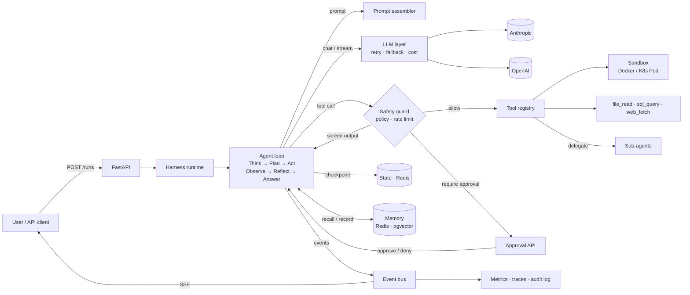

# agent-harness

**Agent = Model + Harness.** The model reasons; the harness makes that reasoning
executable, safe and reliable.

`agent-harness` is an open-source template for building production AI agents: a ReAct
agent loop with budgets and clean stop reasons, provider-agnostic LLMs with retries and
fallback, sandboxed tools, policy and human approval, memory, crash-safe checkpoints,
multi-agent orchestration, tracing, metrics and an eval harness with a regression gate.
It ships as a GitHub template you clone and extend. You can use it to build a single
agent, an internal "agent studio" or your own agent platform.

> **Use this template:** on GitHub, click **Use this template → Create a new repository**.
> (Maintainers: enable it under *Settings → General → Template repository*.)

## Features

| Layer | What you get | Where |
|---|---|---|
| Agent loop | Think → Plan → Act → Observe → Reflect → Answer; max steps, token/cost budgets, wall-clock timeout, a stop reason on every run, parallel tool calls | `src/harness/core` |
| LLM layer | One `LLMProvider` interface; Anthropic + OpenAI adapters; `FakeLLM` for tests; retries with full-jitter backoff and per-call timeouts; provider fallback; token and cost accounting; provider plugins | `src/harness/llm` |
| Prompts | Versioned templates (`react@v1`), memory injection, one-shot context compaction that keeps history append-only (prompt caching and Claude's preserved thinking stay valid) | `src/harness/prompts` |
| Tools | `@tool` registration, JSON-schema argument validation, per-tool timeouts, output caps, `read` / `write` / `dangerous` permissions, plugin entry points | `src/harness/tools` |
| Sandbox | Docker (no network, read-only rootfs, non-root, caps dropped, CPU/memory/PID limits) or one Kubernetes Pod per run (optional gVisor); escape tests in CI | `src/harness/sandbox` |
| Memory | Session history (Redis), long-term semantic memory (pgvector), episodic run records, behind one `MemoryManager` | `src/harness/memory` |
| Safety | YAML policy engine, human approval (pause → approve/deny → resume), prompt-injection screening of tool output, secret redaction, rate limits, hash-chained audit log | `src/harness/safety` |
| State | Checkpoint after every step and tool result, run leases, crash recovery, at-most-once execution for side-effecting tools | `src/harness/state` |
| Orchestration | Supervisor → sub-agents via a `delegate` tool: isolated contexts, shared tools and memory, crash-safe child runs, cost roll-up | `src/harness/orchestration` |
| Observability | OpenTelemetry spans (GenAI conventions), Prometheus metrics, JSON logs with redaction, per-run trace view | `src/harness/observability` |
| Evals | YAML task sets; exact, contains, regex, tool-use and stop-reason scorers; LLM-as-judge rubrics; markdown/JSON reports; baseline regression gate in CI | `src/harness/evals` |
| API | FastAPI: runs, SSE streaming with resume, approvals, cancel, traces, health, metrics; API-key tenancy | `src/harness/api` |
| Deploy | Multi-stage non-root Dockerfile, docker-compose (Redis, pgvector, OTel, Jaeger), Helm chart | `Dockerfile`, `deploy/helm` |

## Architecture



More detail in [docs/architecture.md](docs/architecture.md).

## 5-minute quickstart

Prerequisites: [uv](https://docs.astral.sh/uv/) and, for the sandbox, Docker.

```bash
git clone https://github.com/your-org/agent-harness && cd agent-harness
make setup            # uv sync + pre-commit hooks + .env from .env.example
make sandbox-image    # build the locked-down sandbox image
make demo             # the data analyst agent analyzes examples/data/sales.csv
```

No API key is needed for the demo. Without one, the model is replaced by a scripted
trajectory. Prompting, policy, sandbox, tools, memory and events all run for real.
Add `ANTHROPIC_API_KEY` to `.env` to run the real model.

No Docker? Use the unsafe local sandbox for development only (no isolation):

```bash
HARNESS_SANDBOX_BACKEND=local_unsafe HARNESS_ALLOW_UNSAFE_SANDBOX=true make demo
```

No `make` (e.g. Windows)? Every target is a plain `uv run` command; see the `Makefile`.
For example, `uv run harness run data_analyst "Analyze data/sales.csv and give me insights"`.

### Run the API

```bash
make dev                       # in-memory backends, auto-reload, http://localhost:8000/docs
make up                        # full stack: API, Redis, Postgres+pgvector, OTel collector, Jaeger

curl -s localhost:8000/runs -H "X-API-Key: change-me-local-dev-key" \
  -H "Content-Type: application/json" \
  -d '{"agent": "data_analyst", "input": "Analyze data/sales.csv and give me insights"}'

curl -N localhost:8000/runs/<run_id>/stream -H "X-API-Key: change-me-local-dev-key"   # SSE
curl -s "localhost:8000/runs/<run_id>/trace?format=html" -H "X-API-Key: change-me-local-dev-key"
```

| Endpoint | Purpose |
|---|---|
| `POST /runs` | Start a run (`"wait": true` blocks until it finishes or pauses) |
| `GET /runs/{id}` | Status, answer, usage, cost, pending approvals (`?include_messages=true`) |
| `GET /runs/{id}/stream` | Server-Sent Events; reconnect with `Last-Event-ID` |
| `POST /runs/{id}/approve` | Approve or deny a gated tool call; the run resumes |
| `POST /runs/{id}/cancel` | Cancel a run |
| `GET /runs/{id}/trace` | Step timeline with LLM and tool timings (`?format=html`) |
| `GET /agents` | Configured agents |
| `GET /healthz`, `/readyz`, `/metrics` | Liveness, readiness, Prometheus |

## Create your first agent

Agents are YAML; no Python needed. Add `agents/support.yaml`:

```yaml
name: support
description: Answers questions from the product docs in the workspace.
model:
  provider: anthropic          # or openai, fake, or a provider plugin
  name: claude-opus-5-5
  effort: medium
prompt:
  template: react@v1
  instructions: |
    Answer from the files in docs/. Quote the file you used. If the answer is not
    there, say so.
tools: [file_read]
limits: {max_steps: 8, timeout_s: 120, max_cost_usd: 0.50}
memory: {enabled: true, top_k: 3}
```

Then run `uv run harness run support "How do I reset my password?"`, or `POST /runs` with
`"agent": "support"`. Agent definitions are validated at startup, so a typo in a tool or
sub-agent name fails fast. Use `prompt.template: supervisor@v1`, `tools: [delegate]` and
`sub_agents: [...]` to build a team (see `agents/supervisor.yaml`).

## Add a tool

A tool is an async function. The schema the model sees is generated from its signature
and docstring:

```python
# my_tools/weather.py
from typing import Literal

from harness.tools import Permission, ToolError, make_tool


async def get_weather(city: str, units: Literal["c", "f"] = "c") -> str:
    """Current weather for a city. Returns temperature and conditions."""
    if not city.strip():
        raise ToolError("city must not be empty")  # message goes back to the model
    return f"{city}: 21°{units.upper()}, clear"


weather_tool = make_tool(get_weather, permission=Permission.READ, timeout_s=10)
```

Register it through an entry point. The harness discovers tools from installed packages,
including this repo itself:

```toml
# pyproject.toml
[project.entry-points."harness.tools"]
get_weather = "my_tools.weather:weather_tool"
```

Run `uv sync`, add `get_weather` to an agent's `tools`, and (for `write` or `dangerous`
tools) decide in `policies/default.yaml` who may call it and whether it needs approval.
Tools that need runtime dependencies can register a callable taking the registry. Tools
with side effects should use `ctx.idempotency_key` with downstream APIs. See
[docs/architecture.md](docs/architecture.md#extension-points) for providers and sandboxes.

## Development

```bash
make test        # pytest with coverage (FakeLLM: no API keys needed)
make cov         # + gate: >= 80% on core, tools, safety, sandbox
make lint        # ruff
make typecheck   # mypy --strict
make eval        # offline eval suites vs evals/baseline.json
make check       # everything CI runs
```

Docker sandbox escape tests (`tests/sandbox`) run automatically when a Docker daemon is
available, and always in CI.

## Documentation

- [Architecture](docs/architecture.md): layers, run lifecycle, extension points
- [Safety](docs/safety.md): threat model, policy, approvals, sandboxing, redaction, audit
- [Evals](docs/evals.md): writing task sets, offline vs live, the regression gate
- [Deployment](docs/deployment.md): configuration, docker-compose, Kubernetes/Helm, operations

## License

MIT. See [LICENSE](LICENSE). Contributions welcome; see [CONTRIBUTING.md](CONTRIBUTING.md).
Report vulnerabilities privately as described in [SECURITY.md](SECURITY.md).
