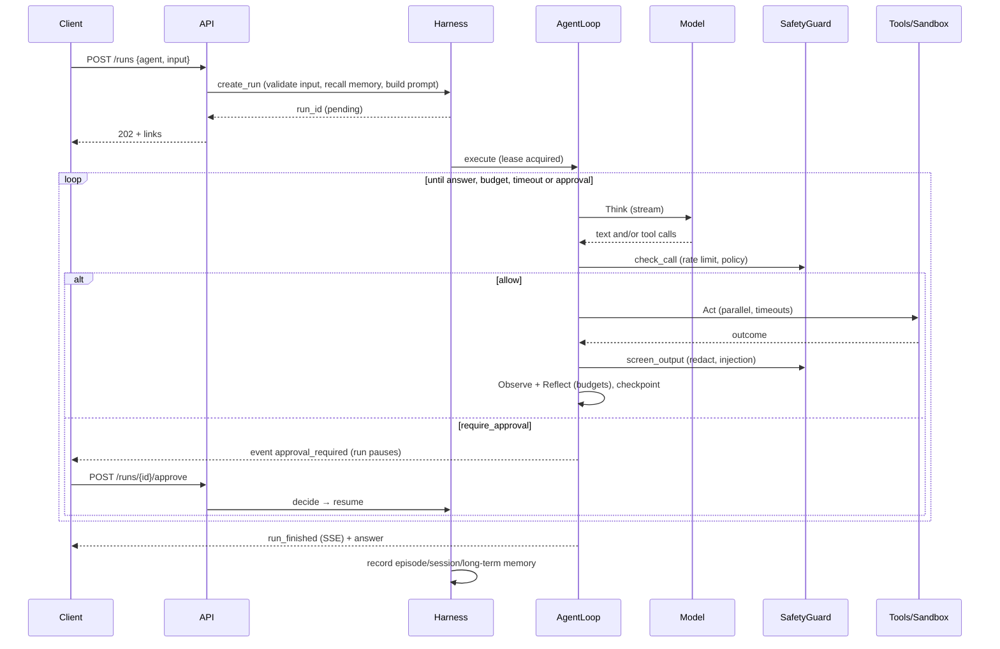

# Architecture

`agent-harness` separates the **model** (which reasons) from the **harness** (which turns
reasoning into safe, reliable execution). Every layer lives in its own package under
`src/harness/` and talks to the others through small interfaces. That lets you replace
any layer: a model provider, a sandbox, a store, a tool.

## Layers

| Package | Responsibility | Key types |
|---|---|---|
| `core` | The agent loop and run state | `AgentLoop`, `RunState`, `AgentSpec`, `Agent` |
| `llm` | Provider-neutral chat, tools, streaming; retries, fallback, cost | `LLMProvider`, `RetryingProvider`, `FallbackProvider`, `FakeLLM` |
| `prompts` | Versioned system templates, memory injection, context compaction | `PromptAssembler`, `compact` |
| `tools` | Registration, schema validation, timeouts, permissions | `ToolRegistry`, `Tool`, `Permission` |
| `sandbox` | Isolated execution of model-written code | `Sandbox`, `DockerSandbox`, `KubernetesSandbox` |
| `memory` | Session, semantic (pgvector) and episodic memory | `MemoryManager` |
| `safety` | Policy, approvals, injection screening, redaction, rate limits, audit | `SafetyGuard`, `Policy`, `ApprovalService` |
| `state` | Checkpoints, leases, idempotency | `StateStore`, `LeaseManager`, `IdempotentExecutor` |
| `orchestration` | Supervisor → sub-agent delegation | `install_delegation` |
| `observability` | Tracing, metrics, structured logs | `span`, `MetricsSink`, `configure_logging` |
| `evals` | Task sets, scorers, reports, regression gate | `run_suites`, `compare` |
| `api` | HTTP + SSE | `create_app` |
| `runtime.py` | Composition root used by API, CLI and evals | `Harness` |

Dependencies point inward. `core` knows only protocols (`ToolExecutor`, `ToolGuard`,
`StateStore`, `MemoryHook`, `EventSink`). Concrete layers implement those protocols, and
`Harness.build()` wires them together from `Settings`.

## Run lifecycle

### Resumability

`RunState` holds everything about a run: messages, usage, cost, elapsed time, pending
approvals, decisions, and a `tool_results` scratchpad. It is checkpointed after every
model turn and every tool result. Where to resume is derived from the messages:

- If the last assistant turn has tool calls without results, the run resumes at **Act**
  and skips calls already in `tool_results`.
- Otherwise it **Thinks**.

So a crashed worker loses at most the work in flight. Another worker picks the run up
after its lease expires (`Harness.recover()` runs at startup). Tools marked
non-idempotent run **at most once**: if a crash happens mid-call, the model is told the
outcome is unknown instead of the tool silently running twice.

### Append-only conversation

The system prompt (including recalled memory) is rendered once per run and frozen. Tool
schemas are fixed per run. History is only appended to. This keeps provider prompt
caches warm and keeps Claude's thinking blocks valid: they are replayed verbatim
(`Message.raw_content`), and editing earlier turns would invalidate them. When the
context outgrows `limits.max_context_tokens`, the loop compacts **once**. It keeps the
system prompt and task, adds a summary note, keeps the recent tail with raw blocks
stripped, then continues append-only from the new base.

### Stop reasons

Every run ends with exactly one `stop_reason`:

| Reason | Meaning |
|---|---|
| `completed` | The model answered |
| `max_steps`, `token_budget`, `cost_budget`, `timeout` | A limit from the agent's `limits` was hit |
| `awaiting_approval` | Paused for a human decision |
| `refused`, `output_truncated` | The model declined or hit its output limit |
| `blocked_by_policy` | Reserved for policies that stop a whole run |
| `llm_error` | The provider failed after retries and fallbacks |
| `cancelled`, `error` | Cancelled by a client, or an unexpected failure (logged with a traceback) |

## Multi-agent orchestration

A supervisor is a normal agent with `tools: [delegate]` and `sub_agents: [...]`. Each
`delegate` call starts a **child run**:

- **Isolated context.** The child gets a fresh prompt and never sees the supervisor's
  conversation.
- **Shared harness.** Same tools, policy, memory, tenant and user.
- **Crash-safe.** The child's run id is derived from (parent run, call id), so a replay
  after a crash resumes the same child instead of spawning another.
- **Accounted.** Child tokens and cost roll up into the parent's budget. Depth is capped
  (`MAX_DEPTH = 3`).
- **Observable.** Children are ordinary runs with `parent_run_id`, visible through the API.

Parallel delegation comes for free: several `delegate` calls in one turn run concurrently.

## Extension points

| To add | Implement | Register |
|---|---|---|
| A model provider (Bedrock, Vertex, local) | `LLMProvider.chat` (+ `stream` if native) | entry point `harness.providers` → `factory(ref, settings)` |
| A tool | async function + `make_tool(...)` | entry point `harness.tools` → `Tool` or `callable(registry)` |
| A sandbox (Firecracker, E2B, ...) | `Sandbox.run_python` | entry point `harness.sandboxes` → `factory(settings)`, select with `HARNESS_SANDBOX_BACKEND` |
| An embedding model | `Embedder.embed` | pass to `build_memory(settings, embedder)` |
| A prompt template | `templates/<name>/vN.md` | built-in, or `HARNESS_PROMPTS_DIR` to override |
| An event consumer (exporter, webhook) | `async def sink(event: RunEvent)` | `harness.extra_sinks.append(sink)` |
| An agent | YAML in `agents/` | loaded at startup |

These are the hooks an "agent studio" or internal agent platform builds on. The API
exposes runs, events, approvals and traces. Agents and policies are data. Providers,
tools and sandboxes are pluggable packages.
